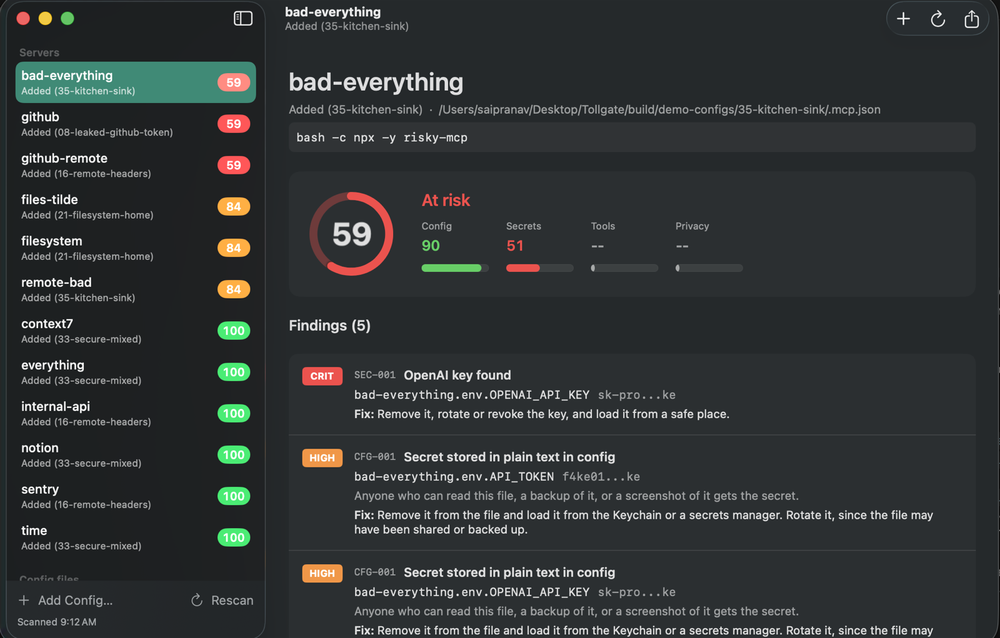
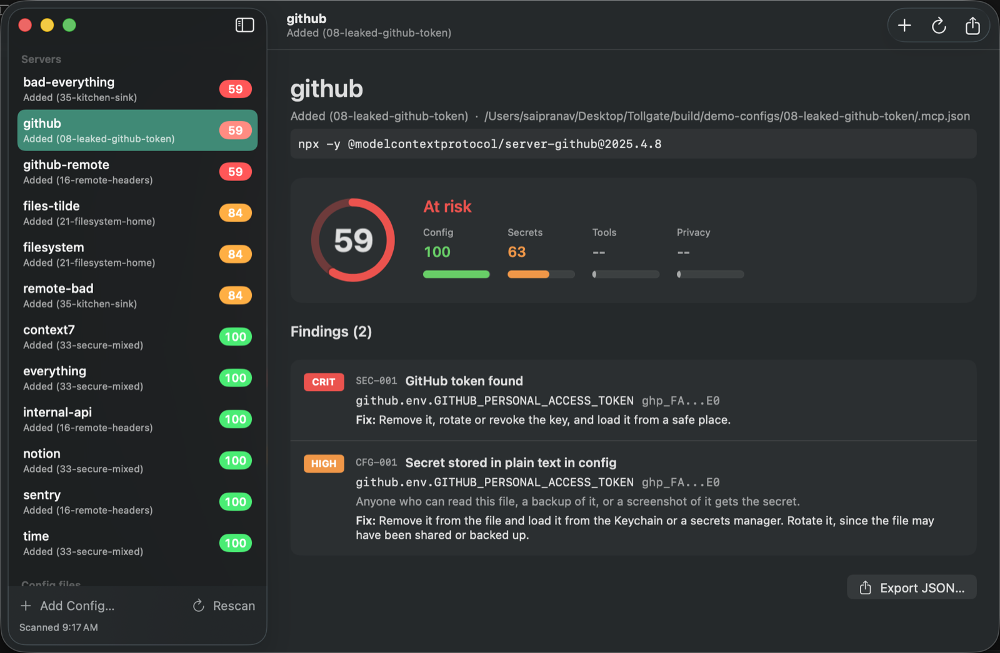
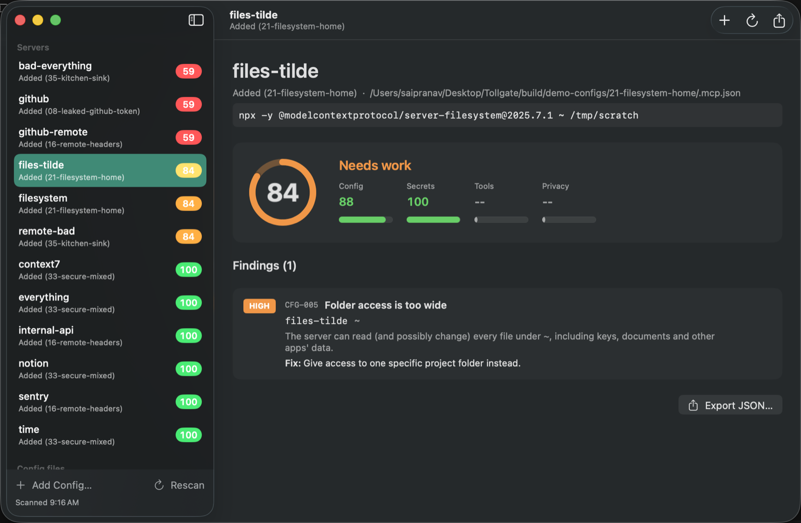
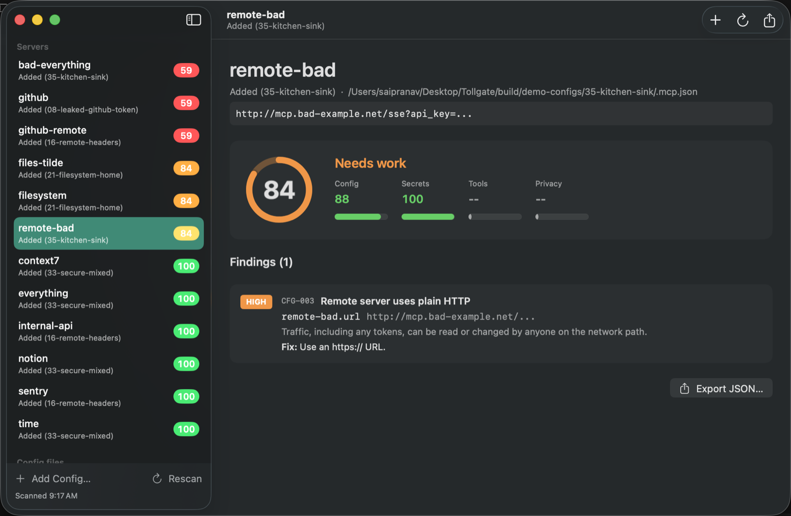
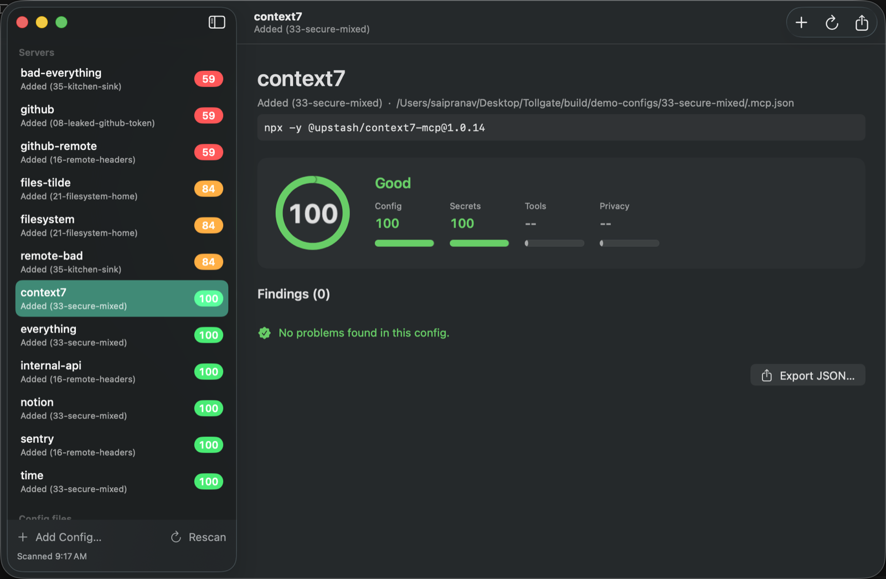
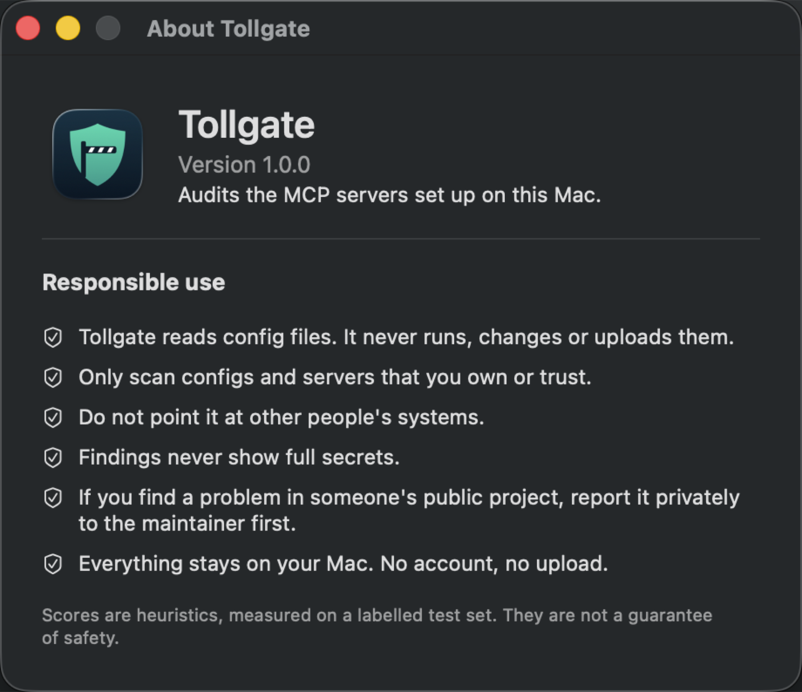

# Tollgate

A native macOS app that finds the MCP servers set up on your Mac, checks their configs for risky settings, and gives each one a 0–100 score with a fix for every problem.



Tollgate **reads config files only**. It never starts a server, never changes a file and never uploads anything.

## Screenshots

All screenshots use the demo configs from `scripts/make-demo-configs.sh`. Every key in them is fake.

**A leaked GitHub token.** The token is recognised by its format and shown redacted. A critical finding caps the score at 59.



**Access to the whole home folder.** A filesystem server given `~` gets a high finding and is capped at 84, Needs work.



**A remote server over plain HTTP.** The API key in the URL is hidden in the app as well.



**A clean config.** A pinned package with no secrets scores 100.



**About and responsible use.**



## What it checks

| Rule | Severity | Detects | Fix |
|---|---|---|---|
| CFG-001 | High | A secret written directly in the config: in `env`, in `headers`, in `args` (`--api-key x`, `--token=x`, `-e NAME=x`), in URL query values, or as the password in a connection string like `postgres://user:pw@host` | Load it from the Keychain or a secrets manager, and rotate it |
| CFG-002 | Medium | A package launched without a pinned version (`npx -y pkg`, `pkg@latest`, `uvx pkg`, `^1.2` ranges) | Pin an exact version |
| CFG-003 | High | A remote server over plain `http://` (not localhost), including URLs passed to proxies like `mcp-remote` and `supergateway` | Use HTTPS |
| CFG-004 | Medium | A server launched through a shell (`sh -c`, `bash -c`) | Run the executable directly |
| CFG-005 | High | A filesystem server given `/`, `~` or your whole home folder, or a Docker container with one of those mounted | Give it one project folder |
| CFG-006 | Low | A server executable or script that other users can modify | Use a path only you can change |
| SEC-001 | Critical | A known key format anywhere in the config: GitHub (classic and fine-grained), Slack, AWS, Google, Anthropic, OpenAI, private key blocks | Remove it and revoke the key |

Values that are clearly not secrets are skipped: references like `${GITHUB_TOKEN}`, README placeholders like `<YOUR_TOKEN>` or `sk-xxxx...`, file paths, and names such as `SSH_KEY_PATH` or `--max-tokens`.

Secrets are always redacted (`sk-pro...ke`) in the app and in the JSON export. A test checks that a full secret never appears in either.

## Where it looks

- Claude Desktop: `~/Library/Application Support/Claude/claude_desktop_config.json`
- Cursor: `~/.cursor/mcp.json`
- Claude Code: `~/.claude.json` (global and per-project servers), plus each known project's `.mcp.json`
- Anything you add with **Add Config…**: a config file, or a folder containing `.mcp.json`, `mcp.json`, `.cursor/mcp.json`, `.vscode/mcp.json` or `claude_desktop_config.json`

Missing or broken files are skipped and shown with a note in the sidebar.

## Scoring

Each category (config, secrets, tools, privacy) starts at 100 and loses points per finding: critical 25, high 12, medium 5, low 1. The total is a weighted average (secrets 35%, config 30%, tools 25%, privacy 10%). Any critical finding caps the total at 59, and any high finding caps it at 84, so one serious problem can't be averaged away into a green score. Grades: 85+ Good, 60–84 Needs work, below 60 At risk.

Tools and privacy are not checked in v1, so they show `--` in the app.

## Accuracy

Tollgate's rules are heuristics, so they are measured on two labelled sets, using fake keys only:

- **Main set** ([`EvalSet/configs`](EvalSet/configs)): 36 configs (69 servers), with copies of public README examples, deliberately insecure configs and secure ones. The rules were tuned on this set.
- **Held-out set** ([`EvalSet/holdout`](EvalSet/holdout)): 16 configs (21 servers), written and labelled *before* the v1.1 rule changes and never used to tune them. They cover the same kinds of problems in new forms, such as MongoDB URIs, `X-API-Key` headers, Docker `-v /:/host`, `supergateway`, Slack user tokens and placeholder keys.

The `EvalTests` test runs both and prints precision and recall per rule.

| Rule | Main set: precision | Main set: recall | Held-out: precision | Held-out: recall |
|---|---|---|---|---|
| CFG-001 secrets in config | 100% (14/14) | 100% (14/14) | 100% (7/7) | 100% (7/7) |
| CFG-002 unpinned package | 100% (14/14) | 100% (14/14) | n/a | n/a |
| CFG-003 plain HTTP | 100% (4/4) | 100% (4/4) | 100% (1/1) | 100% (1/1) |
| CFG-004 shell launch | 100% (4/4) | 100% (4/4) | n/a | n/a |
| CFG-005 wide folder access | 100% (4/4) | 100% (4/4) | 100% (1/1) | 100% (1/1) |
| CFG-006 writable executable | 100% (3/3) | 100% (3/3) | n/a | n/a |
| SEC-001 known key format | 100% (11/11) | 100% (11/11) | 100% (4/4) | 100% (4/4) |
| **All** | **100% (54/54)** | **100% (54/54)** | **100% (13/13)** | **100% (13/13)** |

### How it got there

| Version | Main set precision / recall | Held-out precision / recall | What changed |
|---|---|---|---|
| First run | 84% / 76% | – | |
| v1.0 | 96% / 83% | 50% / 23% | CFG-002 learned each launcher's flags and pin syntax ([before](EvalSet/results-before.md), [after](EvalSet/results-after.md)) |
| v1.1 | 100% / 100% | 100% / 100% | CFG-001 reads headers, args, URLs and connection strings and matches whole words; new Slack and fine-grained GitHub patterns; placeholders skipped; CFG-003 checks proxy URLs; CFG-005 checks Docker mounts ([main](EvalSet/results-v1.1.md), [held-out before](EvalSet/holdout/results-before.md), [after](EvalSet/holdout/results-after.md)) |

### What these numbers do not mean

100% on 90 servers does not mean Tollgate is never wrong. Both sets are small, and the same person wrote the held-out configs and the fixes, knowing which kinds of mistakes they were aimed at. The held-out set shows the fixes work beyond the exact cases they were tuned on. It is not an independent benchmark.

Cases still likely to fool it:
- A secret under a name with no secret word (`SLACK_XOXB`, `CONN`), unless it matches a known key format.
- A real secret that happens to contain a placeholder word such as `example` or `here`.
- A plain-HTTP URL passed to a launcher other than the proxies it knows.

If Tollgate gets one of your configs wrong, an issue with a redacted copy of it is the most useful bug report.

## Build and run

Requirements: macOS 15 or later and Xcode 16 or later.

```sh
open Tollgate.xcodeproj        # then Cmd+R
```

Run the tests (needs the full Xcode toolchain, not only the Command Line Tools):

```sh
cd Packages/MCPShieldCore
DEVELOPER_DIR=/Applications/Xcode.app/Contents/Developer swift test
```

To try it without touching your real configs, generate the evaluation configs with fake secrets and add any of the folders in the app:

```sh
scripts/make-demo-configs.sh   # writes to build/demo-configs
```

The App Sandbox is off because Tollgate has to read config files that belong to other apps.

### Opening a downloaded build

Download `Tollgate-1.1.0.zip` from [Releases](https://github.com/SaiPranav13188/Tollgate/releases), unzip it and move `Tollgate.app` to Applications. It runs on Apple Silicon and Intel Macs.

Release builds are not signed with an Apple Developer ID, so macOS blocks the first launch. To open it:

1. Open `Tollgate.app` once and close the warning.
2. Go to **System Settings → Privacy & Security**, scroll down, and click **Open Anyway** next to the Tollgate message.
3. Confirm with **Open**.

Or, from Terminal: `xattr -dr com.apple.quarantine /Applications/Tollgate.app`

## Project layout

```
MCPShieldApp/                 SwiftUI app (views and view model only)
Packages/MCPShieldCore/       All the logic, no UI: discovery, rules, secrets, scoring, report
  Tests/MCPShieldCoreTests/   Unit tests and the evaluation run
EvalSet/                      Labelled configs, labels.json, before/after results
scripts/                      Demo-config generator
```

## Responsible use

- Tollgate reads files. It never runs, changes or uploads them.
- Only scan configs and servers that you own or trust. Do not point it at other people's systems.
- Findings never show full secrets.
- If you find a problem in someone's public project, report it privately to the maintainer first.
- Everything stays on your Mac. No account, no upload.

Scores are heuristics measured on a small labelled set. They are not a guarantee that a server is safe.

## Roadmap

- **v1.5**: with your explicit approval, start one server, list its tools (`initialize` and `tools/list` only, never tool calls) and check tool names for risky actions and personal data.
- **v2**: remote HTTP servers, SARIF export, a command-line version, git history scan.
